<div align="center">


# PassQ

### Get a passport-office token in two minutes, by speaking Urdu.

**No queue at dawn. No lost workday. No account. No form.**

<p dir="rtl" lang="ur"><b>پاسپورٹ ٹوکن، صرف اردو میں بول کر۔ نہ صبح سویرے کی قطار، نہ پورے دن کا انتظار۔</b></p>


[The problem](#-the-problem-a-day-at-the-passport-office) ·
[The solution](#-the-solution) ·
[Voice agent](#-the-voice-agent) ·
[Architecture](#-system-architecture) ·
[Token engine](#-the-token-engine) ·
[Run it](#-run-it-yourself)

<br/><br/>

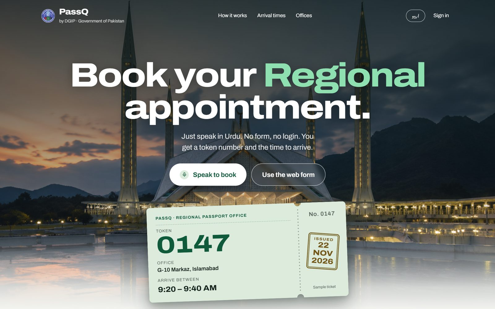

</div>

---

## In 30 seconds

PassQ is a token system for Pakistan's regional passport offices (DGIP). A citizen opens the site, presses one button and **talks to a female voice assistant in plain Urdu**. She asks a few simple questions, narrows Pakistan down to the right office one tap at a time, and finishes with:

> **مبارک ہو! آپ کا ٹوکن نمبر بیالیس ہے۔ آپ صبح آٹھ بج کر بیس منٹ سے آٹھ بج کر چالیس منٹ کے درمیان تشریف لائیں۔**
>
> *"Congratulations! Your token number is 42. Please arrive between 8:20 and 8:40 in the morning."*

The citizen now has a **token, an office, a 20-minute arrival window, a printable slip and a PDF receipt**. They arrive at that time instead of before sunrise. People who prefer a web form can still use one, and both channels draw from **the same live token counter**.

---

## 😓 The problem: a day at the passport office

For many people in Pakistan, getting a passport doesn't start at the office. It starts the night before.

| Time | What happens today |
|---|---|
| **3:30 AM** | A family leaves their village or a far-off town. The nearest regional office can be hours away. |
| **5:00 AM** | They reach the office before sunrise. A queue has already formed outside the gate. |
| **8:00 AM** | The office opens. Nobody knows their place, their number or when they'll be seen. |
| **11:00 AM** | Still waiting, in the heat, with children and elderly parents. Nobody can leave, or they lose their place. |
| **3:00 PM** | Their turn finally comes, or it doesn't, and they're told to come back tomorrow. |
| **Evening** | A whole day gone: **a day off work, a day's wage lost**, travel paid twice if they have to return. |

It isn't easy for the staff either. Hundreds of anxious people arrive at once. Crowds have to be managed instead of applications. Every question is asked again and again at the counter.

**The real problem isn't the passport process. It's that nobody knows *when* to come.**

---

## 💡 The solution

PassQ gives every citizen **a number and a time before they leave home**.

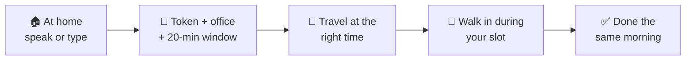

| | **Before PassQ** | **With PassQ** |
|---|---|---|
| When to arrive | Before sunrise, "just in case" | Your own 20-minute slot, e.g. 9:00–9:20 AM |
| Time lost | The whole day | The time of the visit itself |
| Income | A day's wage gone | Keep your workday |
| Knowing your place | Guesswork in a crowd | Token number on a printed slip and a PDF |
| Who can use it | People who can travel early and wait | Anyone who can **speak Urdu**, no reading or typing needed |
| Office staff | Crowd control | A steady, predictable flow: about 35 people per 20 minutes |

### Three ways in

| | Channel | Who it's for | Login |
|---|---|---|---|
| 🎙️ | **Urdu voice agent** at `/voice` | Everyone, especially people who find forms hard | **None** |
| 📝 | **Web application form** at `/token_form` | People who prefer to type and upload documents | Email-verified account |
| 💬 | **Passport help chatbot** | Questions like "which documents do I need?" | Signed-in users |

---

## 🎤 The voice agent

> A government service that **listens in Urdu, answers in Urdu, and never makes you read a list.**

The headline feature: one large button on the home page, **🎤 آواز سے ٹوکن لیں — لاگ ان کے بغیر** ("Get a token by voice, no login"). It works on a phone, a laptop or a kiosk at the office gate.

### What a conversation sounds like

<table>
<tr>
<td align="center" width="25%">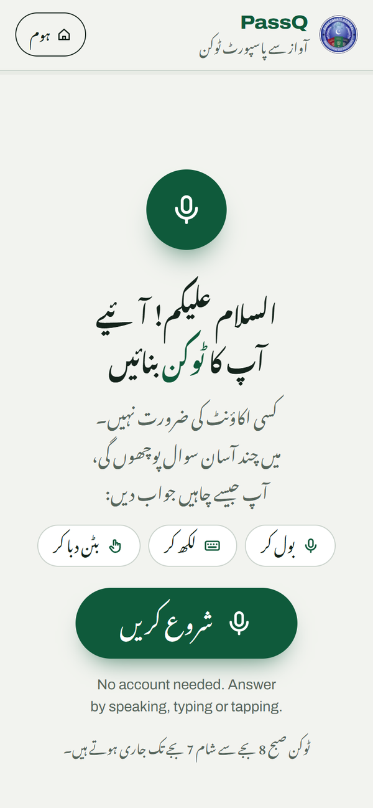</td>
<td align="center" width="25%">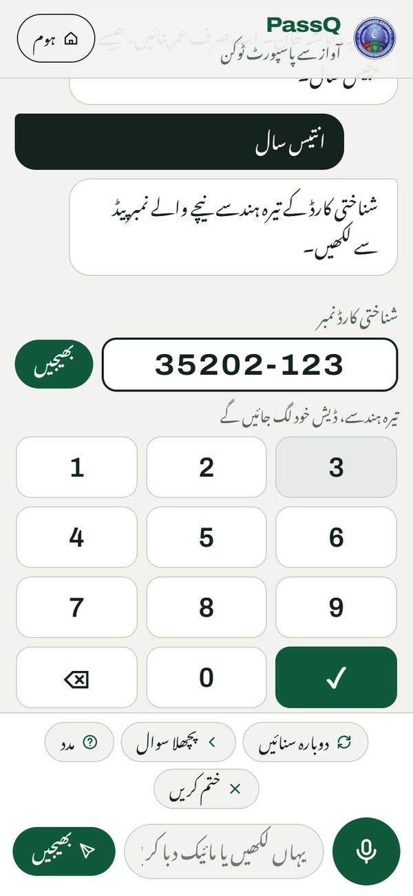</td>
<td align="center" width="25%">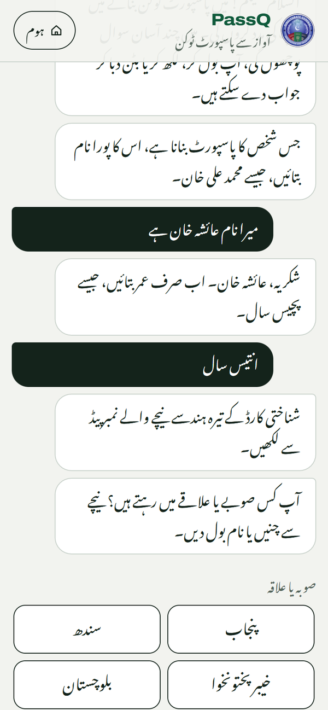</td>
<td align="center" width="25%">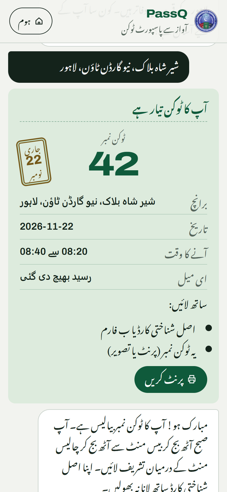</td>
</tr>
<tr>
<td align="center"><sub><b>1 · One button.</b> No account, no form.</sub></td>
<td align="center"><sub><b>2 · CNIC on a keypad.</b> Dashes added for you.</sub></td>
<td align="center"><sub><b>3 · Tap or say it.</b> Bubbles, never a read-out list.</sub></td>
<td align="center"><sub><b>4 · The slip.</b> Token, office, time, what to bring.</sub></td>
</tr>
</table>

| 👩 Assistant (spoken Urdu) | Meaning | 🧑 Citizen |
|---|---|---|
| السلام علیکم! میں پاسپورٹ ٹوکن بنانے میں آپ کی مدد کروں گی۔ | "Hello! I'll help you get a passport token." | — |
| جس شخص کا پاسپورٹ بنانا ہے، اس کا پورا نام بتائیں۔ | "Tell me the full name of the person who needs the passport." | *"Mera naam Muhammad Ali Khan hai."* |
| صرف عمر بتائیں، جیسے پچیس سال۔ | "Just tell me the age, for example twenty-five." | *"Pachees saal."* |
| شناختی کارڈ کے تیرہ ہندسے نیچے والے نمبر پیڈ سے لکھیں۔ | "Type the 13 CNIC digits on the keypad below." | ⌨️ types on a big keypad |
| *(province bubbles appear)* | — | 👆 taps **پنجاب**, or just says it |
| … district → city → nearest office … | — | 👆 one tap each |
| مبارک ہو! آپ کا ٹوکن نمبر … | "Congratulations! Your token number is …" | 🖨️ prints the slip |

### Designed for real people, not demos

- **🫧 It narrows down instead of listing.** Pakistan has 7 regions, 164 districts and 41 regional offices. The agent never reads them out. It shows big tappable bubbles: **province → district → city → office**. Districts that have an office come first, and the offices shown are only those the citizen is allowed to use.
- **⌨️ Speak what's easy, type what's exact.** Names, ages and addresses are spoken. A CNIC and an email are *typed*, on a large keypad that adds the dashes as you type (`35202-1234567-3`) and a simple email box with a **"I don't have an email"** button. Speech recognition is never trusted with 13 digits.
- **🗣️ It understands how people actually talk.** "My name is Ali Khan", "mera naam Ali hai", "پچیس سال", "twenty five" and "۲۵" all work. A language model pulls out just the needed part, and answers are checked against the same rules as the web form.
- **👩 She speaks as a woman, correctly.** The voice is female, so every sentence uses feminine Urdu grammar: *پوچھوں گی*, *سمجھ نہیں سکی*. Urdu speakers notice when this is wrong.
- **🧭 Four words control everything.** Say **دوبارہ** (repeat), **واپس** (back), **مدد** (help) or **ختم** (end) at any time, or tap the matching button.
- **🔢 Numbers and times are spoken naturally.** Not "token 42, 09:00" but *"بیالیس"* and *"صبح نو بجے"*.
- **🧾 It ends with something you can hold.** A slip showing token, office, date, arrival window and what to bring (original CNIC or B-form; parents' CNICs for a child), ready to print. If an email was given, the PDF receipt goes there too.
- **🏛️ It's ready for a kiosk.** The screen clears itself 90 seconds after a finished conversation, and after 4 minutes of silence, so the next person starts fresh. Your data never stays on screen.
- **🛟 It fails gently.** If the microphone, speech service or network drops, it falls back (Groq Whisper → the browser's own recognition → tap or type) and reconnects by itself. When offices are closed or full, she says so in Urdu and offers another office.

### The question funnel

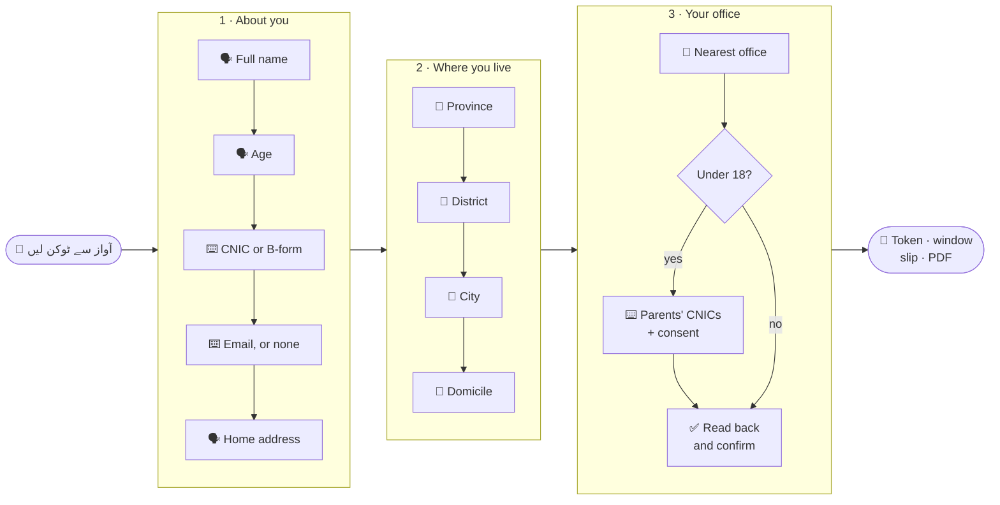

---

## 🖥️ The web app

For people who'd rather type, there's a full bilingual web app. Every screen switches between English and Urdu (right-to-left) with one tap.

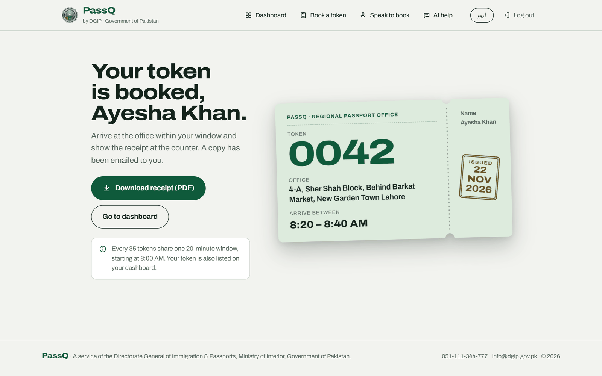

<table>
<tr>
<td width="50%">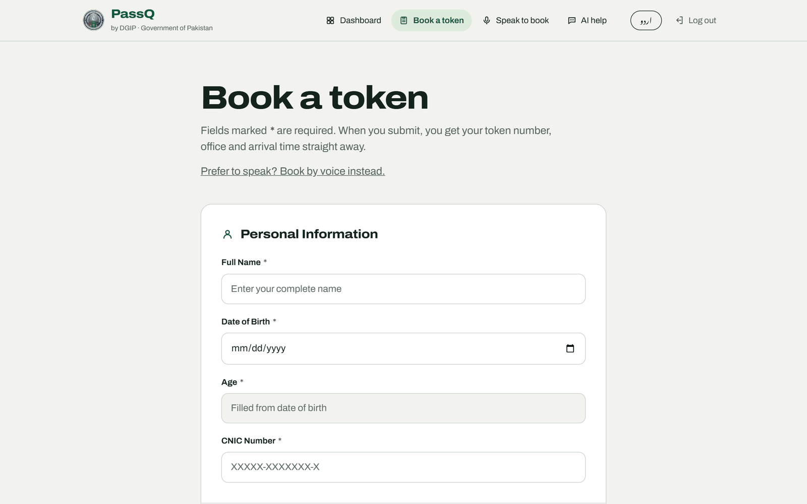</td>
<td width="50%">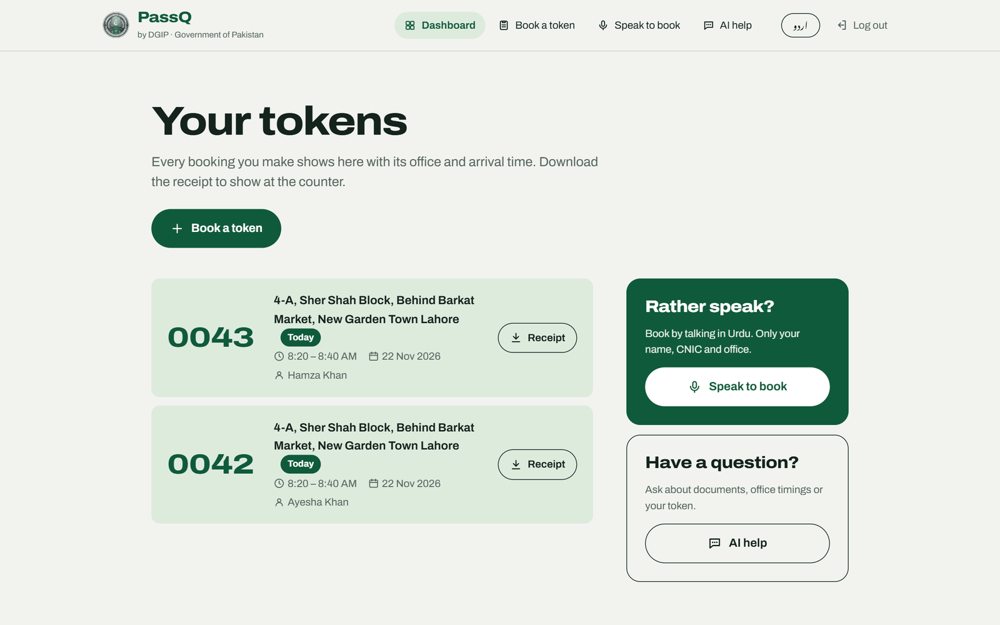</td>
</tr>
<tr>
<td align="center"><sub><b>Book a token.</b> Validated as you type, with a link back to voice.</sub></td>
<td align="center"><sub><b>Your tokens.</b> Every booking with its office, time and PDF receipt.</sub></td>
</tr>
</table>

---

## 🧱 System architecture

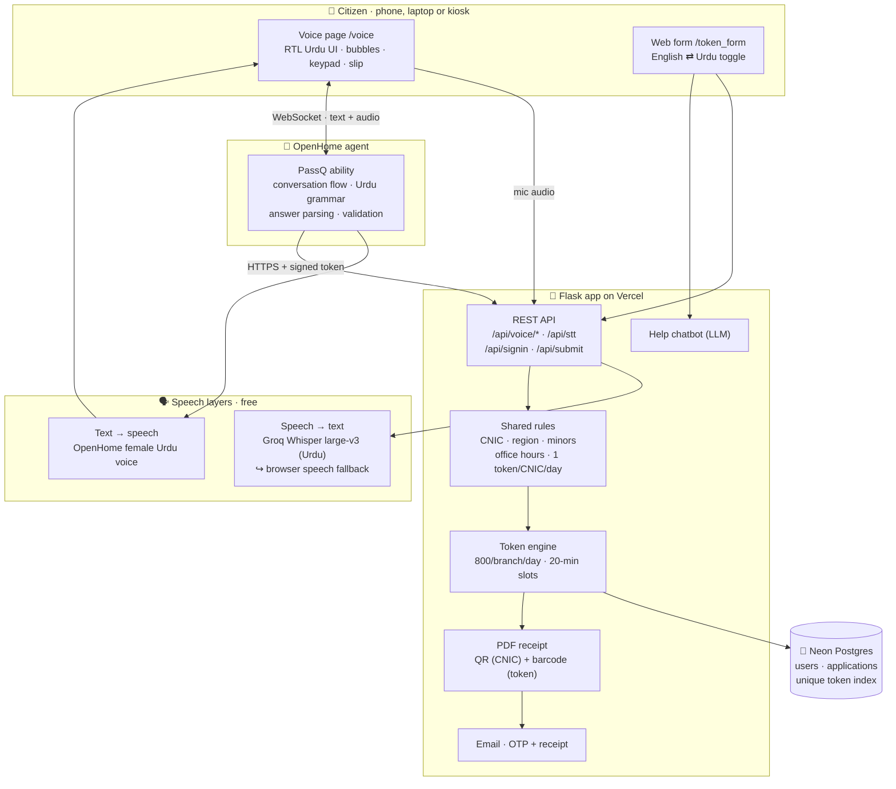

**Who does what**

| Layer | Job | Why this choice |
|---|---|---|
| **Voice page** (`Templates/voice_agent.html`) | Mic, playback, bubbles, keypad, slip, kiosk resets | Works in any modern browser, no app to install |
| **Speech to text** (`speech.py`, `/api/stt`) | Turns Urdu speech into Urdu text | Open-source Whisper large-v3, forced to Urdu, with filters that drop Whisper's known "phantom" phrases |
| **OpenHome agent** (the PassQ ability) | Runs the conversation, speaks in a female Urdu voice | Handles real-time voice streaming and turn-taking |
| **Flask API** (`app.py`) | The single source of truth: validation, tokens, receipts | The voice agent and the web form call **the same functions** |
| **Neon Postgres** | Stores accounts and applications | Serverless Postgres on a free tier, shared by every server instance |

### One spoken turn, end to end

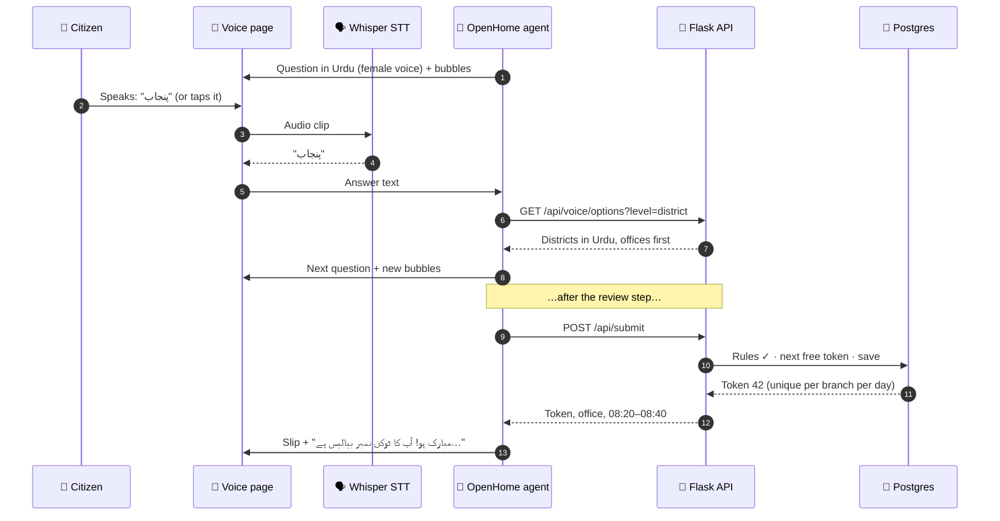

---

## 🎫 The token engine

The fairness rules live in one place (`issue_branch_token` and `save_with_unique_token` in `app.py`), so **a token from the voice agent and a token from the web form come out of the same counter.**

| Rule | Value |
|---|---|
| Regional offices | **41**, across all of Pakistan (`branches.json`) |
| Tokens per office per day | **800** max; when an office is full you're offered another |
| Arrival windows | **20 minutes**, about **35 people** each, starting **8:00 AM** |
| Closing | No tokens after **7:00 PM Pakistan time**, even though the servers run on UTC |
| One per person | **One token per CNIC per day** on the public voice channel; asking again gives back the same token |
| Which office | Your own province's offices, or Islamabad |

**How a token's time is worked out**

```
slot  = (token − 1) ÷ 35          (whole number)
start = 8:00 AM + slot × 20 minutes

token 1   → 8:00 – 8:20 AM
token 42  → 8:20 – 8:40 AM
token 120 → 9:00 – 9:20 AM
```

**No two people ever get the same number.** On a serverless host, several copies of the app can run at the same moment. PassQ handles that in three steps:

1. Every new token is checked against today's saved applications for that office.
2. The database has a **unique rule on (office, day, token number)**.
3. If two requests collide in the same instant, the second one automatically takes the next free number.

All of this was tested by simulating two servers issuing tokens at once.

---

## 🔐 Security and privacy

- **Email-verified accounts** for the web form: 6-digit codes that expire in 10 minutes, 5 wrong tries at most, and limits on how often codes are sent.
- **Strong passwords**, stored only as salted hashes (scrypt / PBKDF2). Passwords containing your own name, CNIC or common words are refused.
- **Identity documents are private.** Uploads are kept outside the public `static/` folder with unguessable file names, so they're never served as public files.
- **The public voice channel is protected.** Its session link is issued only to the PassQ site itself, never cached, and rate-limited. The agent signs in with a short-lived signed token.
- **The same validation everywhere.** CNIC format and region, names, addresses, minors' parents' CNICs and consent, and region-to-office matching are checked on the server for both channels.
- **No secrets in code.** Keys live in environment variables, and error messages never leak internal details.

---

## 🧰 Tech stack: free tiers only

| Area | Technology |
|---|---|
| Backend | Python, Flask, Flask-SQLAlchemy, SQLAlchemy |
| Database | Neon serverless Postgres (SQLite works for local development) |
| Hosting | Vercel (zero-config Flask) |
| Voice agent | OpenHome ability, female Urdu voice |
| Speech to text | Groq **Whisper large-v3** (open source), with the browser's Web Speech API as fallback |
| Chatbot | An open-weight LLM through an OpenAI-compatible API (Groq) |
| Receipts | fpdf2, python-barcode, qrcode, Pillow |
| Email | Flask-Mail over Gmail SMTP (OTP codes and receipts) |
| Frontend | Jinja templates, hand-written CSS and JS, Noto Nastaliq Urdu, full right-to-left layout |

---

## 📁 Project structure

```
PassQ/
├── app.py              # Flask app: pages, REST API, token engine, voice endpoints
├── admin.py            # Validation rules shared by the web form and the voice agent
├── security.py         # Passwords, OTP codes, rate-limit settings
├── office.py           # Per-office daily counters, Pakistan time, 7 PM rule
├── timeslot.py         # Token → 20-minute arrival window
├── locations.py        # Provinces → districts → cities → offices (single source of truth)
├── voice_data.py       # Urdu names for every province, district, city and office
├── speech.py           # Urdu speech-to-text (Whisper via Groq)
├── chat.py             # Passport help chatbot
├── mpdf.py             # PDF receipt with QR code and barcode
├── mail_sender.py      # OTP and receipt emails
├── branches.json       # The 41 regional offices and their daily limits
├── Templates/          # Jinja pages (voice_agent.html, form.html, home.html, …)
├── static/             # CSS, JS (language toggle), images
├── vercel.json         # Vercel function settings
└── requirements.txt
```

---

## 🚀 Run it yourself

### Locally

```bash
python -m venv venv
venv\Scripts\activate            # Windows  (macOS/Linux: source venv/bin/activate)
pip install -r requirements.txt
python app.py                    # → http://127.0.0.1:5000
```

Create a `.env` file next to `app.py`:

| Key | Needed | What it is |
|---|---|---|
| `SECRET_KEY` | ✅ | A long random string: `python -c "import secrets; print(secrets.token_hex(32))"` |
| `SQLALCHEMY_DATABASE_UR` | ✅ | `sqlite:///main.db` locally, or your Neon `postgresql://…` address |
| `MAIL_PASSWOR` | ✅ | Gmail app password, used for OTP codes and receipts |
| `OPENHOME_API_KEY`, `OPENHOME_AGENT_ID` | for voice | Your OpenHome agent |
| `GROQ_API_KEY` | recommended | Free key for Urdu speech-to-text. Without it, the browser's own recognition is used |
| `chat_bot_api`, `base_url`, `model` | for chatbot | Any OpenAI-compatible endpoint |
| `GROQ_STT_MODEL` | optional | `whisper-large-v3` (default) or `whisper-large-v3-turbo` |
| `VOICE_TRIGGER_PHRASE` | optional | Default `پاسپورٹ ٹوکن` |

Tables are created automatically on first start.

### On Vercel

1. Import the repository into Vercel. It detects the Flask `app` in `app.py` by itself.
2. Add every key from the table above under **Settings → Environment Variables**, with `SQLALCHEMY_DATABASE_UR` pointing at Neon.
3. Deploy, then point the OpenHome ability's API address at your Vercel URL.

---

## 🧭 How to use it

**🎙️ By voice (no account)**
1. Open the home page and tap **🎤 آواز سے ٹوکن لیں**.
2. Answer in Urdu. Tap bubbles, type your CNIC on the keypad, and say **دوبارہ** or **واپس** whenever you need to.
3. Listen for your token and arrival time, then print the slip or take a photo of it.
4. Go to the office during your window with your original CNIC or B-form.

**📝 By web form**
1. Sign up with your CNIC and email, then enter the 6-digit code sent to you.
2. Sign in, fill in the token form and upload your CNIC (or B-form and parents' CNICs for a child).
3. Get your token on screen, download the PDF receipt, and it's emailed to you too.

---

<div align="center">

### PassQ turns a queue at dawn into a time on your phone.

<p dir="rtl" lang="ur"><b>قطار کی جگہ وقت — اور وہ بھی اپنی زبان میں۔</b></p>

<sub>Built for a hackathon, on free and open-source tools. Educational and government-use prototype.</sub>

</div>
